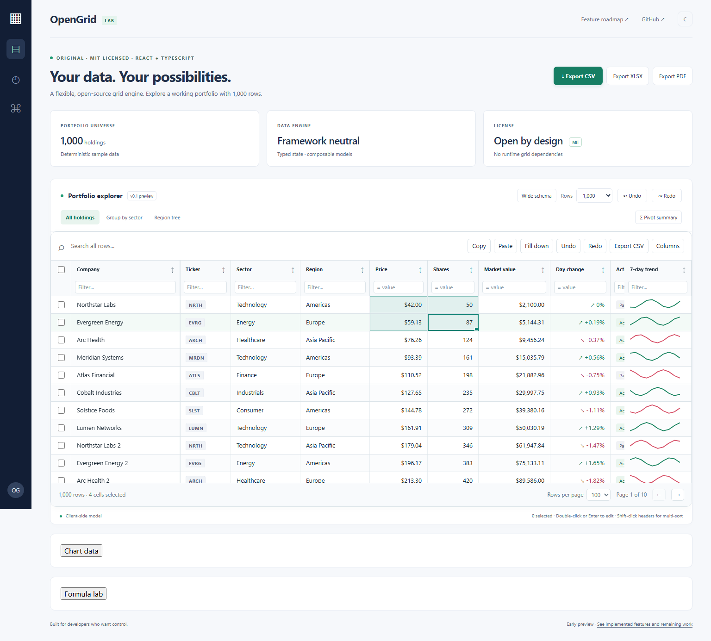

# OpenGrid

[Showcase and documentation](https://mr-rafiq.github.io/opengrid/) · [Interactive playground](https://mr-rafiq.github.io/opengrid/demo/)

An original **MIT-licensed React and TypeScript data grid**, built around a framework-neutral engine. Sorting, filtering, editing, grouping, aggregation, tree data, column controls and virtualized rendering are usable today. This is an early preview with its own API, not a drop-in AG Grid replacement.

The long-term goal covers Community and Enterprise feature families in AG Grid **36.2.0**. Full parity has **not** been achieved. The [feature ledger](docs/FEATURE_PARITY.md) identifies working subsets, limitations and missing capabilities with links to the reference documentation. All OpenGrid functionality in this repository is MIT licensed.



## Try the interactive example

Requires Node.js 24.14+ and npm 11+. No account or license key is needed.

```sh
git clone https://github.com/mr-rafiq/opengrid.git
cd opengrid
npm ci
npm run dev
```

Open the printed localhost URL. Explore up to 100,000 deterministic portfolio rows and a 130-column schema. Try grouped/tree views, nested column headers, cell ranges, validated paste, row editing, Find, notes, advanced filters, nested detail grids, charts, the formula lab, and genuine XLSX/PDF downloads. The remote lab demonstrates grouped server blocks and a live million-row viewport using simulated local providers. Import a bounded XLSX workbook into a separate preview. Data stays in the local browser. The trend graphics are illustrative sample values, not financial data.

## React quick start

The three packages are workspace packages. **They have not been published to npm**, and their npm names have not been reserved or checked for availability. Use the workspace or local tarballs from `npm pack -w @opengrid/core`, `npm pack -w @opengrid/react`, and optionally `npm pack -w @opengrid/export` after building.

```tsx
import { useMemo } from "react";
import { createGrid, type Column } from "@opengrid/core";
import { DataGrid } from "@opengrid/react";
import "@opengrid/react/styles.css";

interface Product {
  id: string;
  name: string;
  price: number;
}
const columns: Column<Product>[] = [
  {
    id: "name",
    field: "name",
    header: "Product",
    editable: true,
    pinned: "left",
  },
  {
    id: "price",
    field: "price",
    type: "number",
    editable: true,
    aggregate: "sum",
    validate: (value) =>
      Number(value) >= 0 ? undefined : "Use a positive price",
  },
];

export function Products() {
  const model = useMemo(
    () =>
      createGrid<Product>({
        rows: [{ id: "p1", name: "Notebook", price: 12 }],
        columns,
        getRowId: (row) => row.id,
      }),
    [],
  );
  return <DataGrid model={model} height={480} ariaLabel="Products" />;
}
```

Treat model state, row objects and callback inputs as read-only. Use `setState`, `setRows`, `applyTransaction`, `editCell` or `batchEdit` to make changes; mutating returned objects bypasses subscriptions and caches. Row IDs must be unique, nonempty, stable strings. Column schemas are fixed when the model is created.

## Working capabilities

- Stable multi-column sort and typed text, numeric, date, boolean, BigInt and membership filter predicates; quick search and pagination.
- Editable fields with parsers, validators, atomic batch changes and bounded undo/redo; add/update/remove transactions.
- Single/multiple row selection, column resize/reorder/hide/pin and configuration chooser.
- Variable-height row and fixed-width column virtualization, retained pinned/focused/editing cells, keyboard navigation and logical ARIA indices.
- Nested column-group headers, collapsible groups, per-row detail regions and independently editable nested grids.
- Rectangular cell selection, Shift-key/pointer extension, quoted TSV copy/paste, atomic validation/undo, down/right fills and numeric/BigInt series.
- Native text/number/date/checkbox/select/multiline editors, asynchronous choices and typed custom-editor hooks.
- Expandable grouping and path-based trees, built-in/custom aggregates and a standalone pivot utility.
- CSV with RFC 4180 escaping and spreadsheet formula neutralization; basic SVG sparklines.
- A safe formula dependency engine with A1/local references, ranges, lazy IF, aggregates, targeted invalidation, cycle diagnostics and resource limits.
- Separate flat infinite, hierarchical server block and live viewport strategies with cache/refresh/retry/stale-request handling.
- Model/range-linked bar, line and scatter SVG charts with configuration controls, an underlying data table and SVG export.
- Optional real XLSX/PDF output with typed workbook cells, multiple sheets, tables/frozen headers and paginated PDF reports.
- Nested typed advanced-filter expressions with a builder, formatted-cell Find, plain-text cell notes and optional atomic row-edit dialogs.
- Optional bounded value-getter caching and schema-driven XLSX import with ZIP/XML resource limits and explicit formula policies.
- Display-only aggregation percentages, running totals and prior differences, with exact BigInt fractions and explicit parent denominators.
- Bounded static print snapshots with explicit refresh, hierarchy/formatting and isolated browser print layout.
- Shared column-order/width/visibility/pinning synchronization across models, with independent row state and disposal.
- Unique current-view rows in sticky top/bottom bands, with stable-ID focus/editing/ranges; custom full-width rows with declared heights and detail regions.
- Managed resident row moves with atomic undo, native drag handles, Alt-arrow controls and explicit eligibility guards.
- Runtime English/Spanish built-in UI localization with typed overrides, translated stored notices and preserved grid/editor state.
- Explicit LTR/RTL layout with physical pins, virtual scrolling, merged-cell geometry, mirrored navigation/resizing and view-ordered ranges/Find.
- Adjacent-value/custom-predicate row spans with compact indexes, offscreen owner retention, keyboard editing and hard layout boundaries.
- Conditional column spans with pin-boundary clipping, owner-aware keyboard editing/Find and bounded horizontal virtualization.
- Compiled read-only calculated columns feeding real sort/filter/group/export pipelines, with same-row dependencies and an add/edit authoring example.
- Controlled custom React filter components and inclusive number/BigInt/ISO-date bounds, preserving valid model filters through invalid drafts and virtualization.

The main browser grid uses the client-side model; separate read-only server and live-viewport React bindings preserve provider order and lifecycle. One cell rectangle is supported; fill extends down/right, and invalid/protected paste rejects the whole transaction. Formula reference rewriting, advanced chart types, full spreadsheet/PDF styling, combined two-dimensional spans and other capabilities remain incomplete. See the ledger for exact scope. Automated accessibility checks are not screen-reader verification.

Detailed guides: [ranges/API](docs/API.md), [remote bindings](docs/REMOTE_GRIDS.md), [formulas](docs/FORMULAS.md), [editors](docs/EDITORS.md), [row editing](docs/ROW_EDITOR_UI.md), [advanced filters](docs/FILTER_BUILDER.md), [Find/notes](docs/FIND_NOTES.md), [column groups](docs/COLUMN_GROUPS.md), [charts](docs/CHARTS.md), [exports](docs/EXPORTS.md), [import](docs/IMPORT.md), [value transforms](docs/SHOW_VALUES_AS.md), [printing](docs/PRINTING.md), and [aligned columns](docs/ALIGNED_COLUMNS.md).

Use the [localization provider](docs/LOCALIZATION.md) for built-in language switching; application values/formatters remain under your control. Set explicit [RTL direction](docs/RTL.md) independently. Touch-specific gestures and physical-device evidence remain open.

Read the [remaining-gap inventory](docs/GAP_INVENTORY.md) for completed bounded contracts and substantive partial/missing families. The [row span guide](docs/ROW_SPANS.md) explains vertical ownership, budgets and supported interactions.

Read the [column span guide](docs/COLUMN_SPANS.md) for merged cell behavior, the rectangle-operation boundary and pure geometry helpers.

Use [managed row moving](docs/ROW_DRAGGING_UI.md) for pointer and keyboard interaction and the [core reorder API](docs/ROW_REORDER.md) for multi-ID operations.

Use the [calculated-column factory](docs/CALCULATED_COLUMNS.md) for compiled derived values, and [custom filter components](docs/CUSTOM_FILTERS.md) to provide controlled React filter interfaces.

## Keyboard controls

Arrow keys move between cells. Home/End move across a row; Ctrl/Cmd+Home/End reach the first/last cell on the rendered page. Page Up/Down move by the visible area. Enter/F2 or double-click starts an edit, Escape cancels, and Enter/Tab commits. Space toggles a row. Shift-click a header for multiple sort keys. Focus a column separator and use Left/Right to resize. The column chooser provides keyboard-operable move/pin/hide controls.

Shift-click or Shift+navigation extends a cell rectangle. Ctrl/Cmd+A selects visible data cells, C copies and V pastes. Ctrl/Cmd+D fills down and R fills right. Drag the range corner to repeat values; Alt-drag extends a numeric series. Multiline editors commit with Ctrl/Cmd+Enter. Clipboard permission failures are reported in the grid.

Ctrl/Cmd+F opens Find in the current view. Alt+N opens the focused cell's note. Alt+Enter toggles an available detail region. Optional row editing opens a modal with explicit Save/Cancel; its accepted changes share one undo entry.

## Development and verification

```sh
npm run check                  # strict TypeScript, unit/React tests, package and demo builds
npx playwright install chromium
npm run test:e2e               # real Chromium interactions and axe-core scan
```

GitHub Actions runs these checks on push and pull requests. See [verification evidence](docs/VERIFICATION.md), [API](docs/API.md), [architecture](docs/ARCHITECTURE.md), [research provenance](docs/RESEARCH.md), and [contribution guide](CONTRIBUTING.md).

## License and provenance

[MIT](LICENSE). OpenGrid is independent of AG Grid Ltd and has no AG Grid runtime dependency. Its implementation was written from public feature documentation, without copying enterprise source or removing license controls. AG Grid and its product names belong to their respective owners. Repository name availability was checked under `mr-rafiq` only; no claim of globally unique branding or npm name availability is made. Third-party runtime and development dependencies retain their own licenses; see [notices](THIRD_PARTY_NOTICES.md).
