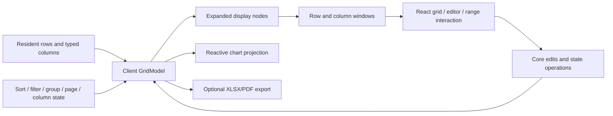

# Architecture

OpenGrid separates data processing, provider lifecycles, browser interaction and optional file generation. It is an original implementation with its own API. AG Grid documentation informs user-facing requirements; it is not a code dependency or compatibility contract.

## Packages and ownership

| Location          | Responsibility                                                                                                           | Boundary                                                                            |
| ----------------- | ------------------------------------------------------------------------------------------------------------------------ | ----------------------------------------------------------------------------------- |
| `packages/core`   | Client grid, state, edits/history, transactions, grouping/tree, ranges/TSV, analytics, remote stores and formula engines | No React/DOM or bundled backend/transport.                                          |
| `packages/react`  | DataGrid, both-axis windowing, focus, typed/custom editors, range/clipboard/fill interaction, charts/sparklines and CSS  | Data mutations go through core; chart data is projected from the model.             |
| `packages/export` | Real XLSX/PDF bytes through dynamically loaded ExcelJS/pdf-lib                                                           | Optional package; no automatic writes/downloads; document limits explicit.          |
| `examples/demo`   | Interactive composition of library modules and example data                                                              | Application controls are not automatically DataGrid features.                       |
| `tests`           | Real-browser integration and downloads                                                                                   | Provider fixture/component tests remain separate from backend/browser verification. |

`types.ts` defines the client `GridModel<T>`. Stable row and column IDs carry identity across sort/filter/reorder. Positions are display coordinates, not identity. A `RowNode` distinguishes source data from synthetic groups. Ranges, remote stores and formulas have additional contracts in their own modules; they are not all serialized inside `GridState`.

## Client data and rendering flow

The client pipeline filters, stably sorts, builds groups or a path tree, flattens expanded nodes and applies pagination before the rendering window. Pagination counts displayed group nodes as well as data rows. The React range controller uses visible data-row IDs from the current page. Chart/export row policies differ intentionally and are documented in [charts](CHARTS.md) and [exports](EXPORTS.md); they must not silently inherit DOM-window limits.

Rows remain resident regardless of DOM window size. Horizontal windowing creates spacers for omitted columns while preserving total width, logical ARIA indices and pinned/focused columns. Fixed sizes are required; variable heights, spanning and RTL are outside this strategy. Offscreen keyboard navigation scrolls and restores focus after the target cell mounts.

## State, edits and ranges

The client model owns data and view state; React owns transient focus, editor drafts and pointer interactions. Retain one model per grid and subscribe through stable snapshots. Snapshot consumers must not mutate returned state or borrowed row payloads. JSON persistence needs explicit BigInt encoding and a future migration/version policy.

Parsers/validators run before publication. A batch commits all changes or none and forms one undo unit. Paste/fill reuse that path so protected/invalid/out-of-bounds operations do not partially write. Transactions use stable IDs; replacing rows and applying client transactions clear edit history. Range selection is one rectangle, separate from row selection, with endpoint invalidation after schema/view changes.

Native editor controls use string drafts; BigInt is not converted through Number. The React host owns final keyboard navigation and commits. Async option providers receive cancellation and request-identity guards; failures expose retry. Custom editors must preserve draft/commit/cancel/error semantics. See [editors](EDITORS.md).

## Distinct remote provider stores

`InfiniteDataSource` is a flat cached block loader. `ServerSideRowModel` is a hierarchical route/block store that forwards sort/filter/group/aggregate/pivot queries, validates results and supports cache refresh/retry plus atomic updates to loaded nodes. `LiveViewportRowModel` owns a buffered absolute-index subscription and server-pushed rows/counts. Each controls cancellation, stale generations, validation and cleanup according to its own contract.

These primitives are standalone. They do not make the client `DataGrid` a complete server renderer. Applications still bind loaded nodes/placeholders/errors, expansion/result columns, selection, transport and backend persistence. A loaded-node cache update is not an HTTP write. Provider-fixture tests establish store behavior, not production service availability. See [remote models](REMOTE_MODELS.md).

## Formula and analysis modules

`FormulaEngine` parses an original AST language, records dependencies, memoizes results, invalidates affected dependents and returns typed errors under resource budgets. Formula registration is explicit; arbitrary edited/pasted strings never silently execute. Constructor row/column order binds positional references to stable cells. Structural migration, formula-aware editors and fill/reference rewrites remain outside the engine. The older `evaluateFormula` helper remains a smaller independent arithmetic utility. See [formulas](FORMULAS.md).

Pivoting is a client projection utility plus server query/metadata forwarding, not a complete interactive grid pivot mode. `GridChart` is a model-reactive SVG panel with finite-number projection, bounded sampling, controls/table and SVG export. It has no full chart persistence/cross-filtering/pivot-chart framework. These are meaningful slices with explicit boundaries, not aliases for complete parity.

## Optional document output

`@opengrid/export` reads model values and returns actual OOXML/PDF bytes. It does not scrape React renderers. Dependencies load on demand. Ordinary XLSX formula-like strings stay strings; formula descriptors require explicit opt-in. PDF's standard Helvetica path supports WinAnsi, rejecting unsupported text rather than silently corrupting it. CSV/TSV keep formula-prefix safeguards. File validation uses independent ZIP/PDF readers; native import remains absent.

## Verification and accessibility

Core tests cover algorithms, precision, atomicity, formula graphs and provider lifecycles. Component tests cover editors, charts, ranges and logical windows. Browser tests cover real scrolling/focus, pointer/keyboard behavior, clipboard and downloads. Packaging verifies ESM/declarations and optional dependency boundaries. The [verification record](VERIFICATION.md) owns executed results.

Named controls, visible focus, logical positions, live errors and keyboard alternatives are necessary but do not establish screen-reader conformance. Manual reader/browser/OS scenarios, touch and broader cross-browser evidence remain gaps. The [feature ledger](FEATURE_PARITY.md) defines the supported subsets; full AG Grid parity is not claimed.
