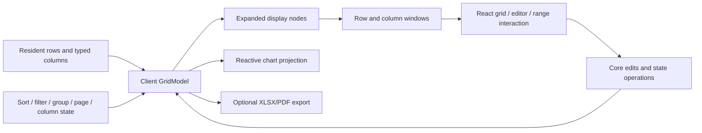

# Architecture

OpenGrid separates data processing, provider lifecycles, browser interaction and optional file generation. It is an original implementation with its own API. AG Grid documentation informs user-facing requirements; it is not a code dependency or compatibility contract.

## Packages and ownership

| Location          | Responsibility                                                                                                           | Boundary                                                                            |
| ----------------- | ------------------------------------------------------------------------------------------------------------------------ | ----------------------------------------------------------------------------------- |
| `packages/core`   | Client grid, state, edits/history, transactions, grouping/tree, ranges/TSV, analytics, remote stores and formula engines | No React/DOM or bundled backend/transport.                                          |
| `packages/react`  | DataGrid, both-axis windowing, focus, typed/custom editors, range/clipboard/fill interaction, charts/sparklines and CSS  | Data mutations go through core; chart data is projected from the model.             |
| `packages/export` | Real XLSX/PDF bytes through dynamically loaded ExcelJS/pdf-lib                                                           | Optional package; no automatic writes/downloads; document limits explicit.          |
| `examples/demo`   | Interactive composition of library modules and example data                                                              | Application controls are not automatically DataGrid features.                       |
| `tests`           | Real-browser integration and downloads                                                                                   | Provider fixture/component tests remain separate from backend/browser verification. |

`types.ts` defines the client `GridModel<T>`. Stable row and column IDs carry identity across sort/filter/reorder. Positions are display coordinates, not identity. A `RowNode` distinguishes source data from synthetic groups. Ranges, remote stores and formulas have additional contracts in their own modules; they are not all serialized inside `GridState`.

The core also contains the validated advanced-filter AST/external-predicate pipeline, bounded getter cache, literal Find controller, plain-text note store and staged row-edit sessions. React exports the corresponding builder/dialogs, grouped headers, variable-height layout and separate remote bindings. The optional document package now includes bounded XLSX import as well as export.

## Client data and rendering flow

The client pipeline filters, stably sorts, builds groups or a path tree, flattens expanded nodes and applies pagination before the rendering window. Pagination counts displayed group nodes as well as data rows. The React range controller uses visible data-row IDs from the current page. Chart/export row policies differ intentionally and are documented in [charts](CHARTS.md) and [exports](EXPORTS.md); they must not silently inherit DOM-window limits.

Rows remain resident regardless of DOM window size. Horizontal windowing uses fixed column widths and spacers while preserving total width, logical ARIA indices and pinned/focused columns. Client rows support explicit variable heights through prefix-sum geometry; detail blocks add known heights. Independent and bounded combined column/row spans layer owner rectangles, physical pins and inline RTL navigation onto this geometry. Automatic content measurement remains open. Offscreen keyboard navigation scrolls and restores focus after mounting. Nested group headers retain logical spans and split at pin/order boundaries; client collapse keeps one representative leaf and restores prior visibility.

Row projection resolves current-view leaf IDs into unique top/body/bottom bands before rendering and navigation. Focus and cell references use stable row IDs, not mutable visual indices. Only the body virtualizes; both sticky bands remain mounted and subtract their known heights from body/fill-scroll geometry. Full-width rows keep one colspan cell, retain optional detail blocks, and omit absent per-column cells from range/Find domains. Projection never changes core sort/filter/page/export state. See [row bands](PINNED_FULL_WIDTH_ROWS.md).

## State, edits and ranges

The formula engine and calculated-grid factory share a tokenizer/parser/evaluator program layer. Cell formulas retain positional references and dependency invalidation; calculated definitions compile once with symbolic same-row references. Generated read-only getters participate in ordinary grid pipelines and opt out of generic getter memoization to avoid caching error projections. A separate bounded controller cache observes model snapshot and canonical row identities without subscriptions or notifications during reads. Explicit expiry refreshes the model, and schema replacement remains an application action with history reset.

The client model owns data and view state; React owns transient focus, editor drafts and pointer interactions. Retain one model per grid and subscribe through stable snapshots. Snapshot consumers must not mutate returned state or borrowed row payloads. JSON persistence needs explicit BigInt encoding and a future migration/version policy.

Parsers/validators run before publication. A batch commits all changes or none and forms one undo unit. Paste/fill reuse that path so protected/invalid/out-of-bounds operations do not partially write. Transactions use stable IDs; replacing rows and applying client transactions clear edit history. Range selection is one rectangle, separate from row selection, with endpoint invalidation after schema/view changes.

Native editor controls use string drafts; BigInt is not converted through Number. The React host owns final keyboard navigation and commits. Async option providers receive cancellation and request-identity guards; failures expose retry. Custom editors must preserve draft/commit/cancel/error semantics. See [editors](EDITORS.md).

Whole-row editing stages raw fields in a separate `createRowEditSession`, validates the final staged row and commits one batch. `RowEditDialog` provides explicit Save/Cancel/reload with conflict handling. Client `editMode="row"` opts into this modal path; default cell mode retains inline editing. This is not reference inline full-row blur-save semantics or backend persistence.

Find uses literal formatted text and stable cell IDs; the client bar restricts it to current-page visible data rows and restores focus through virtual scrolling. Notes stay outside row data/history in a bounded versioned store; native modal UI renders text literally. Advanced filtering applies per-column conditions, a validated AND/OR/NOT AST, external predicate and quick terms with AND; callbacks stay outside serialized state. Getter caching is opt-in bounded LRU, invalidated by data generations or explicit expiry; formatter output is not cached.

## Distinct remote provider stores

`InfiniteDataSource` is a flat cached block loader. `ServerSideRowModel` is a hierarchical route/block store that forwards sort/filter/group/aggregate/pivot queries, validates results and supports cache refresh/retry plus atomic updates to loaded nodes. `LiveViewportRowModel` owns a buffered absolute-index subscription and server-pushed rows/counts. Each controls cancellation, stale generations, validation and cleanup according to its own contract.

The provider stores remain independent of client `DataGrid`. Separate read-only `ServerDataGrid` and `LiveViewportDataGrid` now bind them to React: server route/block paging and drilldown versus sparse absolute-index live scrolling. Both surface load/error/retry state and retain provider authority. Full mixed-route expansion, automatic pivot schemas, server-wide selection and write workflows remain absent. Backend persistence and transport belong to the application; a loaded-node cache update is not an HTTP write. Provider/component tests are not production service availability. See [remote models](REMOTE_MODELS.md) and [bindings](REMOTE_GRIDS.md).

## Formula and analysis modules

`FormulaEngine` parses an original AST language, records dependencies, memoizes results, invalidates affected dependents and returns typed errors under resource budgets. Formula registration is explicit; arbitrary edited/pasted strings never silently execute. Constructor row/column order binds positional references to stable cells. Structural migration, formula-aware editors and fill/reference rewrites remain outside the engine. The older `evaluateFormula` helper remains a smaller independent arithmetic utility. See [formulas](FORMULAS.md).

`createFormulaGrid` is a separate fixed-sheet adapter using the shared safe parser/evaluator directly. Raw expression atoms stay in editable fields; computed scalar reads feed the normal model pipeline. A package-private WeakMap factory seam adds read resolution, final candidate validation and semantic atom equality without exposing arbitrary public mutation hooks or making editable columns into read-only getters. The public model/controller registry lets React automatically seed raw Formula/Literal drafts. Runtime evaluation emits no model notifications; bounded caches and candidate work are separate from public FormulaEngine diagnostics. Raw column validation and computed final-sheet validation remain distinct. See [editable formula grids](FORMULA_GRID.md).

Pivoting is a client projection utility plus server query/metadata forwarding, not a complete interactive grid pivot mode. `GridChart` is a model-reactive SVG panel with finite-number projection, bounded sampling, controls/table and SVG export. It has no full chart persistence/cross-filtering/pivot-chart framework. These are meaningful slices with explicit boundaries, not aliases for complete parity.

Analytical value transforms are separate display-matrix projections over one explicitly selected measure. Percentages use row/column/grand totals or supplied parent-denominator tables; ordered modes use supplied axis order. Exact BigInt fractions stay distinct from Number values. Diagnostics/resource budgets are explicit; raw grid values, sorting and state remain unchanged. `createAlignedColumns` is another independent core utility: shared-ID column layout propagation only, with bounded feedback handling and owned disposal. It does not synchronize browser scroll positions or row/filter/selection state.

## Optional document output

`@opengrid/export` reads model values and returns actual OOXML/PDF bytes without scraping React renderers. Dependencies load on demand. Formula-like XLSX strings stay strings; formula descriptors require explicit opt-in. PDF's standard Helvetica path supports WinAnsi and rejects unsupported text. CSV/TSV retain formula safeguards. Independent ZIP/PDF readers validate output.

`importXlsx` preflights all archive parts using actual expanded-byte/count/depth budgets before workbook parsing, then maps/parses/validates a preview. It never writes to a grid or evaluates formulas. Formula policy and applying accepted rows are explicit application decisions. Merges/named ranges, macros/encryption/legacy formats and arbitrary workbook fidelity are unsupported/rejected. See [import](IMPORT.md).

`GridPrintView` is a third output path: a bounded captured HTML table, independent of virtual rendering, with explicit stale/refresh semantics and user-triggered browser printing. Print-only isolation targets one instance and cleans up markers/listeners; paper behavior remains browser/printer controlled. It does not generate PDF bytes or capture nested detail DOM. The React grid separately integrates unique current-view pinned bands and declared-height full-width rows through its row projection; this does not establish nested-detail print fidelity or nonresident pinned totals.

## Verification and accessibility

The [alignment guide](ALIGNED_COLUMNS.md) and [focused tests](../packages/core/src/aligned-columns.test.ts) establish shared-column state/constraint propagation, feedback bounds and lifecycle handling. This evidence adds neither scroll synchronization nor atomic rollback across runtime model failures.

Core tests cover algorithms, precision, atomicity, formula graphs and provider lifecycles. Component tests cover editors, charts, ranges and logical windows. Browser tests cover real scrolling/focus, pointer/keyboard behavior, clipboard and downloads. Packaging verifies ESM/declarations and optional dependency boundaries. The [verification record](VERIFICATION.md) owns executed results.

Named controls, visible focus, logical positions, live errors and keyboard alternatives are necessary but do not establish screen-reader conformance. Manual reader/browser/OS scenarios, touch and broader cross-browser evidence remain gaps. The [feature ledger](FEATURE_PARITY.md) defines the supported subsets; full AG Grid parity is not claimed.

Column geometry now flows through the pure bounded resolveColumnWidths allocation. DataGrid combines measured client width, manual state and a local resize preview once, then supplies that map to headers, pins, spans, scrolling and horizontal virtualization. Container-driven flex does not publish model state. Each mounted grid owns an explicit rendered-text sizing controller with bounded typography metrics, cancellation fences and one atomic manual-width publication; lifecycle replay creates a fresh controller. See [column sizing](COLUMN_SIZING.md).

Explicit size-to-fit reuses the constrained allocator with configured-width ratios. A frozen model defaults record separates original widths from getColumns' current-state projection. The controller preserves excluded committed geometry, deducts leading controls, guards planning against stale model/view/container state and publishes all visible widths together. Ownership includes excluded flex columns so later flex allocation cannot change the requested fit; hidden overrides and data history remain intact.

Combined spans validate copied row/column metadata before application callbacks, then join vertical runs only for identical horizontal owner footprints. Width-free topology preserves pixel-only reuse; source/order/visibility/pin/direction changes rebuild it. Horizontal plans and comparison values are construction-local, bounded by 100,000 projected cells. Rendering retains rectangle origins intersecting both windows, while navigation resolves horizontal coverage before vertical owners. Bulk/export semantics remain independent work; see [rectangular merged cells](COMBINED_SPANS.md).

Flat column condition groups own primitive operands and freeze after bounded preparation; nested logic stays in the scalar-leaf advanced AST. Compiled child predicates and membership indexes belong to one calculation. Remote stores prepare and clone before invalidating requests/caches. Staged widgets guard fresh applied-source reads as well as controlled mirrors.

Built-in filter dialogs portal to a stable host within the grid root, outside movable virtual header nodes and the grid row tree. This preserves native modality through RTL/reorder changes while inheriting theme, direction and locale. Own-root/column focus checks retain the correct virtual header; a panel may set its own language for nested locale providers. See [column conditions](COLUMN_FILTERS.md).

Rich choice editors separate an immutable bounded string-option index, an abortable open-session source hook and a staged native-modal renderer. Exact IDs never pass through Number. The renderer virtualizes fixed-height options while retaining its active ARIA descendant. DataGrid and RowEditDialog provide direct apply callbacks to their existing validation/history/session owners; custom controlled hosts use a fenced draft-mirroring bridge. Provider identity and editing ownership fence late asynchronous work; locale-only changes rebuild local search without reopening or refetching. See [searchable choices](RICH_SELECT.md).
