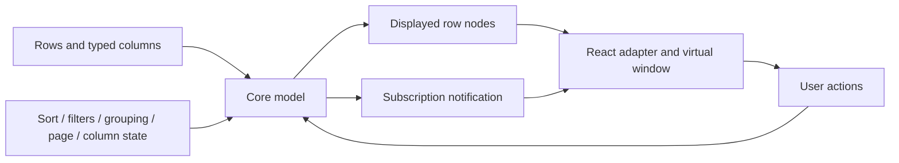

# Architecture

OpenGrid separates data processing from browser rendering. It is an original implementation with a deliberately small public API; AG Grid documentation is a behavior reference, not a source-code dependency or API-compatibility contract.

## Packages

| Location         | Responsibility                                                                                                 | Boundary                                                                                       |
| ---------------- | -------------------------------------------------------------------------------------------------------------- | ---------------------------------------------------------------------------------------------- |
| `packages/core`  | Typed column definitions, grid state, client row processing, edits/history, transactions and CSV serialization | No React, browser DOM or network dependencies.                                                 |
| `packages/react` | Rendering, focus/edit sessions, row windowing, pin layout, controls and CSS                                    | Consumes `GridModel<T>`; data mutations go through the model.                                  |
| `examples/demo`  | Interactive application showing supported capabilities                                                         | Example-specific data, charts or controls are not library features unless exported and tested. |
| `tests`          | Browser integration and cross-feature behavior                                                                 | Tests exercise public user interactions and built package behavior where appropriate.          |

`packages/core/src/types.ts` is the shared model contract. Callers supply a stable `getRowId`; row positions are display coordinates and must not become data identities. Column IDs identify state even when columns move or become hidden. `RowNode<T>` distinguishes leaf data from generated group nodes.

## Data flow

The intended client-side pipeline is source rows → quick/column filters → stable multi-key sort → grouping or path tree → expansion flattening → pagination → rendering window. Integration tests must establish the actual ordering and document any deviation. Pagination acts on the displayed row model; it is not a server datasource. Rendering fewer DOM nodes does not reduce source-row storage.

## State and ownership

The model owns row data and data-only view state. React owns transient focus, pointer interaction and edit input. Consumers should retain one model instance per grid and subscribe rather than recreate it during every render. State snapshots contain IDs and values, not callbacks or rendered React elements. Persistence applications must encode BigInt filter values explicitly because native JSON does not serialize BigInt.

Callbacks such as getters, formatters, comparators, parsers, validators and aggregators are consumer code. They should be deterministic and side-effect-free; the grid may call them repeatedly. They do not constitute a safe expression language. Do not evaluate user-provided JavaScript to implement calculated columns or formulas.

Edits should parse and validate before publication. A batch either commits all edits or none, with one undo unit. Transactions use stable IDs and require defined duplicate/missing-ID policy. External data replacement and transaction history behavior must be covered by tests rather than inferred from an API name.

## Rendering and accessibility

The initial rendering strategy uses fixed row heights. The virtual window includes an overscan buffer; offscreen keyboard movement must scroll first and restore focus when the target cell mounts. Pinned columns use computed offsets from effective widths and order. ARIA positions must describe the logical grid, not the index within the current DOM window.

Roving tab stops, labeled controls, visible focus, edit cancellation, validation feedback and expansion semantics are responsibilities of the React adapter. Automated checks are useful evidence but do not establish screen-reader compatibility. Manual assistive-technology results require browser, reader, OS, version and scenario records.

## Extension seams and missing systems

The public callback seams support custom values and cell content today only when implemented and verified in the parity ledger. Future row-model providers need their own request/cancellation/cache lifecycle. Infinite flat blocks, grouped server-side requests and viewport live subscriptions must remain distinct strategies. A generic fetch callback is not sufficient for all three.

Formula parsing, end-user calculated columns, pivot schemas, clipboard ranges, XLSX/PDF and integrated chart state should be separate modules with explicit serialization and resource ownership. Avoid inflating the core with chart/export dependencies. CSV export must neutralize formula-like prefixes by default. Actual XLSX output requires OOXML; actual PDF output requires PDF bytes and document-level tests.

## Verification layers

1. Pure core tests cover order, filtering, precision, group/tree identity, edit atomicity, history and export safety.
2. React tests cover rendered semantics and controlled interactions.
3. Real-browser tests cover scrolling, focus through virtualization/pinning, pointer resize, downloads and integration.
4. Packaging checks build declarations/ESM and verify imports from packed artifacts.
5. Manual audits cover screen readers, touch, contrast and product behavior beyond automated coverage.

The [feature ledger](FEATURE_PARITY.md) is the support boundary. Planned interfaces and design descriptions here must never be presented as shipped capabilities.
